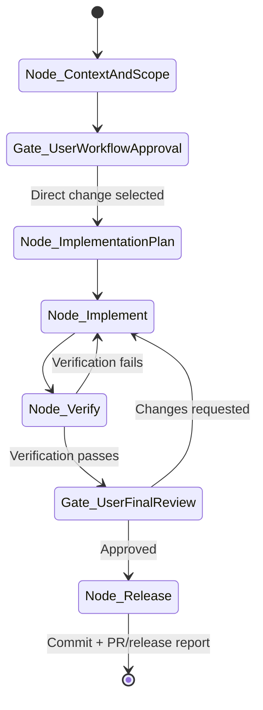

<!-- TEMPLATE_VERSION: 1.0.0 -->
---
description: Focused single-agent workflow for contained feature or fix changes that do not require hotfix speed or parallel work.
---

# Direct Change Workflow

A focused, single-agent workflow for bounded changes in one domain or a small set of closely related files. It preserves inspection, planning, verification, and user approval without the full multi-agent pipeline.

---

## 1. When to Choose Direct Change

Choose this workflow only after the user selects it.

Use it when:

- The change is contained in one domain or one architectural boundary.
- The implementation can be understood and completed in one working context.
- The task is not an urgent production hotfix.
- Parallel research, independent implementation slices, or a separate architecture/review agent would add overhead rather than confidence.

Do not use it when the task is an urgent production incident, spans independent workstreams, changes high-risk boundaries, or needs parallel investigation. Recommend `hotfix` or `multiple agents` instead.

---

## 2. Direct Change Flow



---

## 3. Execution Steps

### Step 1: Recommend and Confirm the Workflow

Before creating task artifacts or editing production code:

1. Classify the task as `hotfix`, `multiple agents`, or `direct change`.
2. Recommend one workflow with a brief reason based on urgency, scope, coupling, regression risk, and parallelism.
3. Ask the user to select a workflow.
4. Pause until the user selects one or explicitly authorizes the assistant to choose.
5. Record the selected workflow in the task context and `STATE.json`.

### Step 2: Context and Scope

1. Initialize task state:
   ```bash
   python3 .agents/scripts/manage-state.py --action=init --task=<TASK_ID> --complexity=<SMALL|MEDIUM>
   ```
2. Read the relevant route wiring, handler, service, repository, schema, tests, and generated/config boundaries.
3. Write `.agent-work/<TASK_ID>/TASK_CONTEXT.md` with the goal, scope, affected files, acceptance criteria, and explicit non-goals.
4. Present the scope and pause for user approval before implementation.

### Step 3: Implementation Plan

1. Write `.agent-work/<TASK_ID>/IMPLEMENTATION_PLAN.md`.
2. Include the smallest file set, data-flow impact, migration needs, verification commands, and rollback concerns.
3. Do not delegate unless the user changes the workflow selection.

### Step 4: Direct Implementation

1. Apply the smallest focused change.
2. Preserve existing route, response, auth, pagination, and database boundaries.
3. Avoid unrelated refactors, dependency changes, or broad architecture changes.
4. Review `git diff` before verification.

### Step 5: Verification

1. Run the relevant targeted checks.
2. Run `bun run typecheck` after code changes.
3. Run `bun run test` when runtime behavior is affected.
4. Run `git diff --check`.
5. Record results in `.agent-work/<TASK_ID>/QA_REPORT.md`.
6. If verification fails, fix the root cause and repeat verification; do not widen scope silently.

### Step 6: User Review and Release

1. Present the change, verification results, remaining risks, and manual verification steps.
2. Pause for the user's final approval.
3. After approval, create the conventional commit, push the selected branch, and create or update the pull request.
4. Verify the remote branch and PR state before reporting completion.

---

## 4. Direct Change Guardrails

- Direct change means one implementation context, not skipping discovery or verification.
- If the task expands beyond the original bounded scope, stop and recommend switching to `multiple agents`.
- If a production incident or urgent regression appears, stop and recommend switching to `hotfix`.
- The user chooses the workflow; the assistant recommends but does not silently choose.
